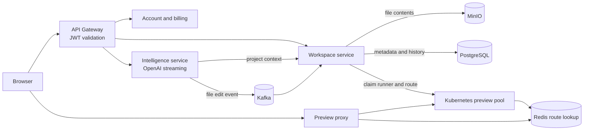
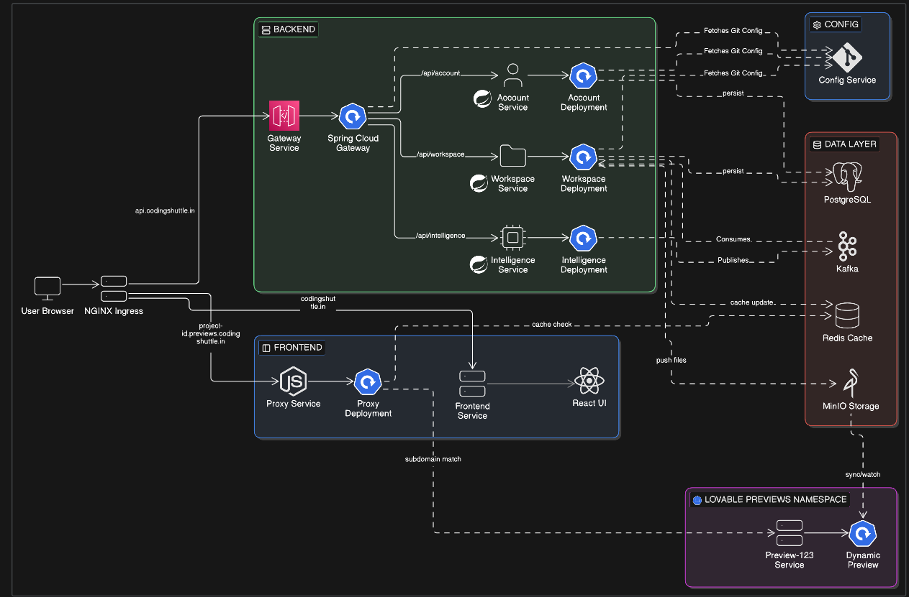
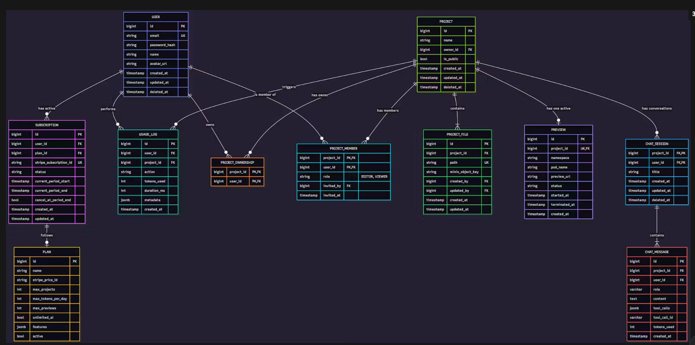
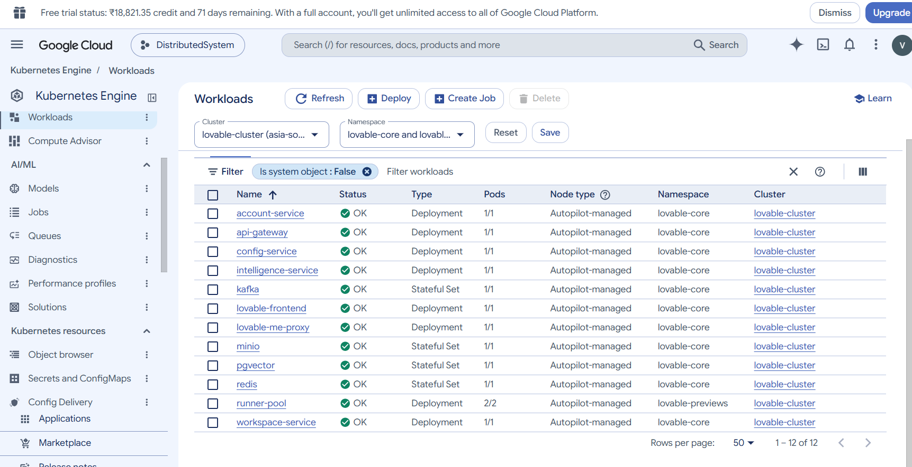

<div align="center">

# Distributed Lovable

### An AI-powered project workspace, built as a set of cooperating services.

A backend platform for turning a conversation into a working project workspace. Users can create projects from a starter app, collaborate through project roles, ask an AI assistant to edit files, and launch an isolated preview. Those workflows are split across independently deployable Spring services rather than packed into one application.


</div>

---

## The idea

Distributed Lovable is the backend and deployment foundation for an AI-assisted coding workspace. It brings together accounts and subscriptions, project collaboration, AI chat and file generation, and live project previews. The codebase focuses on the services and infrastructure behind that experience; the frontend itself is deployed as a container image and its source is not included here.

### How a project moves through the system

1. A user signs up or logs in and receives a signed JWT. The gateway validates bearer tokens for protected routes.
2. The workspace service creates a project, adds its owner, checks the user's plan limit, and copies a React/Vite starter project from MinIO. Project records and file metadata live in PostgreSQL.
3. A prompt is streamed through the intelligence service using server-sent events. The AI workflow can read the project's file tree through the workspace API and uses Spring AI's OpenAI integration.
4. Generated file edits are published to Kafka. The workspace service stores file contents in MinIO, updates PostgreSQL metadata, and sends a response event so the corresponding chat event can be marked complete or failed.
5. When a project is deployed, the workspace service claims an idle Kubernetes preview runner, syncs project files into it, starts the Vite development server, and registers the preview route in Redis. A Node.js proxy forwards browser traffic to that runner.

Account management also includes Stripe checkout, a customer portal, subscription status updates, and webhook handling.



## Architecture

The diagram below shows the intended end-to-end topology, including the browser-facing layer, backend services, shared data infrastructure, and dynamic project previews.



[Open the detailed Distributed Lovable architecture PDF](https://cs-prod-assets-bucket.s3.ap-south-1.amazonaws.com/Distributed_Lovable_Architecture_59c9e57e96.pdf)

## Services at a glance

| Module | What it does |
| --- | --- |
| `api-gateway` | Reactive Spring Cloud Gateway entry point. Validates bearer JWTs and forwards configured routes. |
| `account-service` | Signup/login, JWT-backed identity, plan/subscription operations, Stripe checkout and webhooks. |
| `workspace-service` | Project lifecycle, plan-based project limits, member roles, file tree/content, and Kubernetes previews. |
| `intelligence-service` | OpenAI-backed chat streaming, project context, chat history, usage records, and generated file-edit events. |
| `config-service` | Spring Cloud Config Server, configured to read service settings from a Git repository. |
| `discovery-service` | Netflix Eureka registry for service discovery. |
| `comman-lib` | Shared JWT/security helpers, DTOs, permission/event types, Feign support, and API error handling. |

### Service communication

Synchronous requests use HTTP APIs and OpenFeign clients. Kafka connects the AI file-edit workflow to workspace storage, with request/response events and processed-event tracking. Each main domain service has a separate PostgreSQL database in the Kubernetes initialization manifest; MinIO stores project file contents, while Redis holds preview host-to-runner mappings.

## Technology

| Area | Technologies in this repository |
| --- | --- |
| Language and framework | Java 21, Spring Boot 4.1.1, Spring Cloud 2025.1.3 |
| APIs and service communication | Spring MVC, Spring Cloud Gateway, OpenFeign, REST |
| Service platform | Eureka discovery, Spring Cloud Config, Spring Boot Actuator |
| Identity and validation | Spring Security, JWT utilities, Jakarta validation |
| Identity, access, billing | Spring Security, signed JWTs, project roles, Stripe subscriptions |
| AI | Spring AI with OpenAI, reactive streaming, project-context tools |
| Persistence and messaging | PostgreSQL 16 with pgvector image, Spring Data JPA, Apache Kafka |
| Object storage and preview routing | MinIO, Redis |
| Deployment | Jib-built OCI images, Kubernetes workloads, ingress, network policies, isolated preview runners |
| Build | Java 21, Maven Wrapper, a separate Maven project per module |

## Data model

The schema diagram covers users and plans, subscriptions, projects and memberships, project file metadata, previews, chat sessions/messages/events, and usage records. The Kubernetes PostgreSQL initializer creates separate `account_db`, `workspace_db`, and `intelligence_db` databases.



## Deployment view

The `k8s/` folder describes the core and preview namespaces, service deployments, PostgreSQL/Kafka/MinIO/Redis infrastructure, ingress, and network policies. The preview runner pool uses a Node.js container plus a MinIO sync sidecar; the proxy looks up each preview host in Redis and forwards HTTP and WebSocket traffic. The supplied GKE console image is a deployment illustration, not a live status check.



Deployment manifests are organized under [`k8s/`](k8s/):

- `services/` contains application workload definitions.
- `stateful/` contains Kafka, MinIO, pgvector, and Redis definitions.
- `infra/` contains ingress, namespaces, network policies, and the preview runner pool.
- `proxy/` contains the preview proxy deployment and its Node.js implementation.
- `proxy/` contains the preview proxy deployment and its Node.js implementation.

The frontend deployment manifest points to a separately built frontend image. Frontend application source is not part of this repository.

## Repository layout

```text
.
├── account-service/       # Account and identity APIs
├── api-gateway/           # External API routing
├── comman-lib/            # Shared backend components
├── config-service/        # Central configuration
├── discovery-service/     # Eureka service registry
├── intelligence-service/  # AI chat and generation
├── workspace-service/     # Projects, files, members, previews
├── k8s/                   # Kubernetes and preview infrastructure
└── assets/                # Architecture, schema, and deployment diagrams
```

## Build and run

Each module is a separate Maven project with its own wrapper; there is no root Maven reactor. Install the shared library first, then build or test the service you want:

```powershell
cd comman-lib
.\mvnw.cmd install

cd ..\account-service
.\mvnw.cmd test
```

On macOS or Linux, use `./mvnw install` and `./mvnw test`. Repeat the test command from each service module as needed. To run a Spring Boot service locally, use `spring-boot:run` from that module after its configuration and dependencies are available.

A working service also needs access to the Git-backed Config Server and its configured dependencies, including PostgreSQL, Kafka, Redis, and MinIO where used. The AI, billing, and deployment paths additionally require their provider credentials and Kubernetes access. Review module configuration and manifests before running; provide secrets through environment variables or Kubernetes Secrets, not source control.

## Project notes

Before publishing or deploying, scan tracked files for credentials and rotate any secrets that may already have been committed. The architecture, schema, and GKE images are included as project documentation; they do not by themselves guarantee that a live cluster is currently available.
